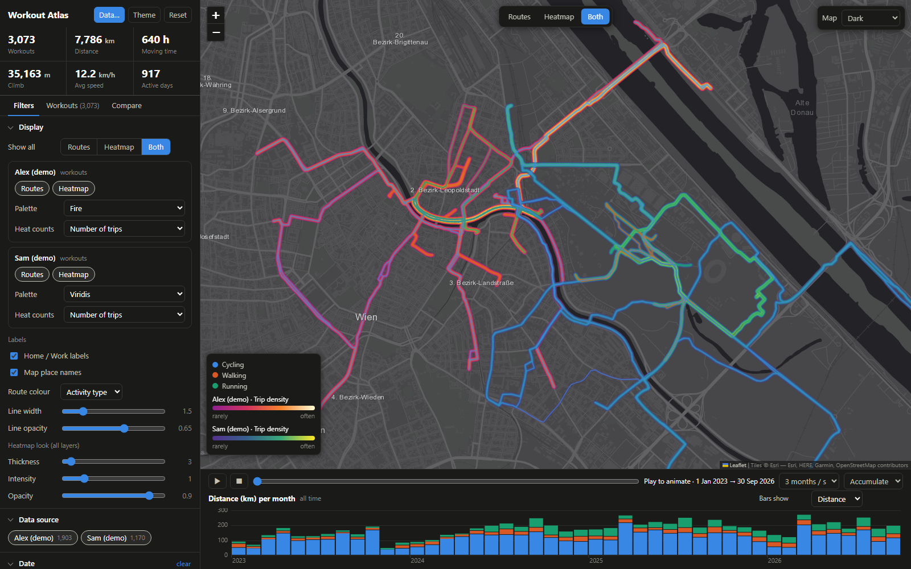
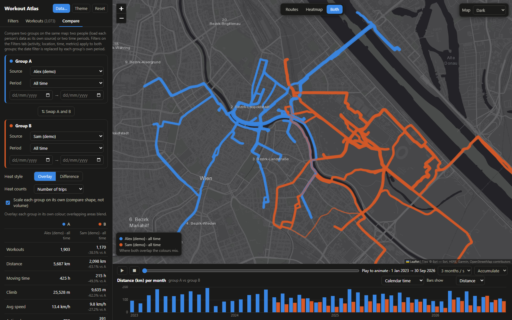

# Workout Atlas

A single-file, offline-first dashboard for exploring your own location data on a map:
Apple Health workout routes, GPX files, and Google Timeline location history. Everything is
parsed in your browser; nothing is uploaded.



<sub>Screenshots use **synthetic demo data**: two made-up people whose trips are routed along real Vienna streets (street data © OpenStreetMap contributors, base map © Esri), not anyone's real routes. Regenerate with `python tools/make_demo.py`.</sub>

- **Routes and heatmaps**, with per-source layers (each data source has its own style, palette and counting method, drawn on top of each other)
- **Filters**: date (or brush the monthly chart), activity, place, time of day / week / month, distance, duration, speed, climb
- **Play**: animate routes building up over time
- **Compare**: two people or two time periods, overlay or difference heatmap, stats table
- **Blank map** option, and switchable place labels
- **Load your own data** in the page: Apple Health `export.zip`, a folder of `.gpx` files, or a Google Timeline `location-history.json`

### Compare two people or two periods



## Use it

Open `index.html` in a browser (Chrome, Edge, Firefox or Safari), click **Data…** and add your files.
Sources can be remembered in the browser (IndexedDB) so you only import once.

The page needs an internet connection for the map library and tiles (Leaflet, Esri, OpenStreetMap),
and for the zip reader (fflate) the first time you open a `.zip`.

Because it is one static file, it also works on GitHub Pages or any static host: the host only serves
the page, your files are read locally in your browser.

## Repository layout

```
index.html        the whole app (HTML, CSS, JS)
build.py          optional: bake an Apple Health export into a personal copy
tools/make_demo.py  generates synthetic demo data (used for the screenshots)
data/             your exports (git-ignored; see data/README.md)
dist/             build output (git-ignored)
docs/             ROADMAP.md and the README screenshots
```

### Optional: a personal copy that opens with your data already loaded

```bash
python build.py                      # reads data/export.zip, writes dist/workout_atlas_personal.html
python build.py path/to/export.zip   # or point at an export elsewhere
```

`dist/workout_atlas_personal.html` contains your routes (and therefore where you live). It is git-ignored; don't publish it.

## Privacy

Your data never leaves the browser. `data/` and `dist/` are git-ignored, as are `*.zip`, `*.gpx` and `*.json`,
so exports and built pages with data cannot be committed by accident. Check `git status` before pushing.
